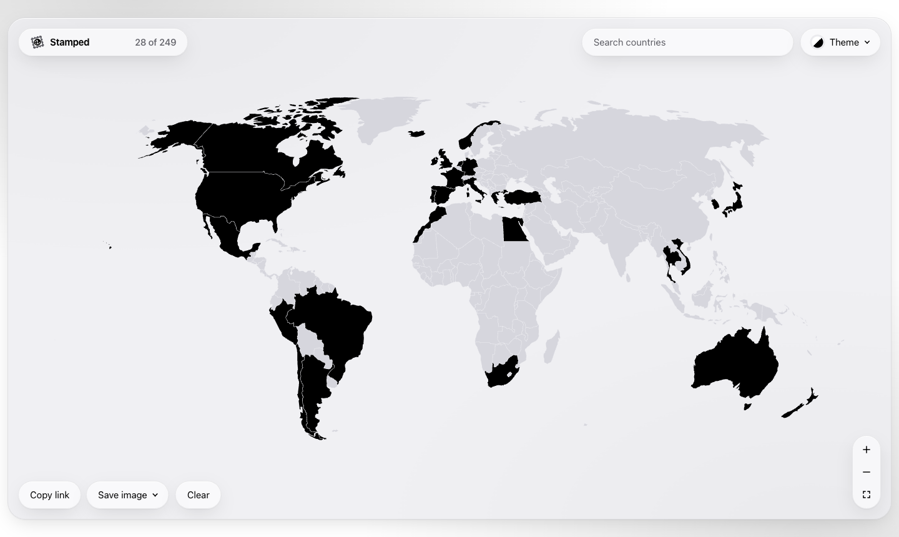

<div align="center">

# <picture><source media="(prefers-color-scheme: dark)" srcset="docs/logo-dark.svg"></picture> Stamped

A map of the countries you've visited, shareable! Stamp countries.<br>
No account, no server, no tracking.

<picture>
    <source media="(prefers-color-scheme: dark)" srcset="docs/screenshot-dark.png">
    
  </picture>
</div>

## Features

- Search every country and territory, even the tiny ones
- Stats for continents, UN members and share of the world
- Save the map as an image: post, story or wide
- A passport that opens like a book, with a stamp for every country
- Disputed territories too: Kosovo, Northern Cyprus, Somaliland
- In 6 languages, picked from your browser
- Your map stays saved in the browser
- 11 themes, light and dark
- Works on phones and ultrawide screens

## Roadmap

- [ ] Wishlist countries
- [ ] Check for missing countries
- [x] Disputed territories
- [x] Passport view
- [ ] Save the passport as an image
- [ ] Different passport covers
- [ ] Intro dialog on first open
- [ ] States, regions and cities
- [x] i18n
- [ ] Accounts
- [ ] 3D globe view

## Fast by design

One HTML page of about 47 KB gzipped, plus a binary map. The map is a single canvas, the UI is Vue Vapor, and no geo code ships to the browser.

## Run it

Needs Node 24.

```bash
npm install
npm run dev
```

## Data

Country shapes come from [Natural Earth](https://www.naturalearthdata.com/), public domain.
